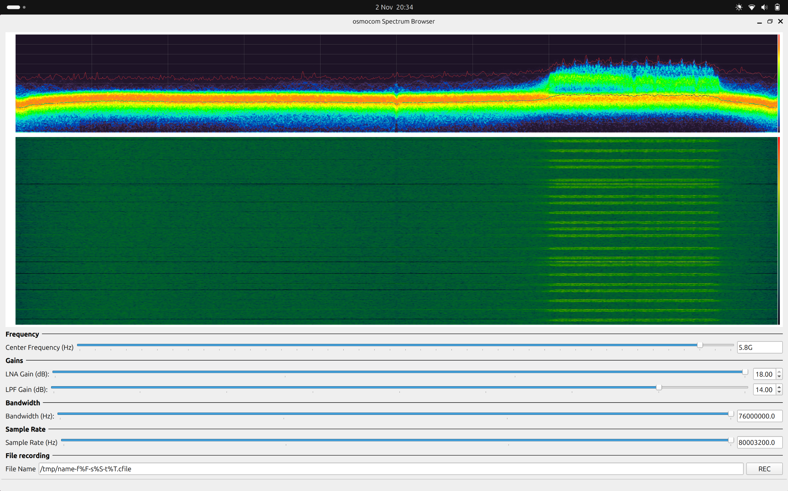
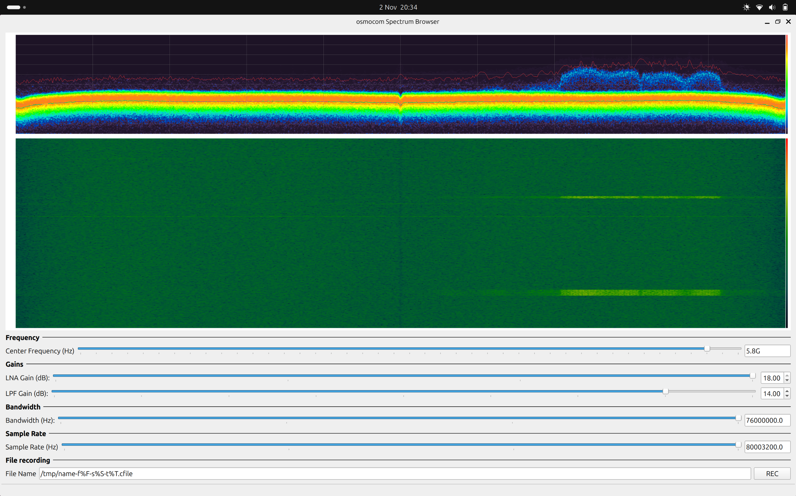

gr-fosphor - gnuradio block for RTSA-like spectrum visualization
================================================================

Modified to work with Wayland and mesa-rusticl, with CL/GL context sharing for Intel IRIS on Ubuntu 26.10 (no XWayland)
Intel's own ICD (NEO) doesn't suppot CL/GL context sharing on Wayland, apparently.
AI did all the work.

I am using an MT7921AU Wi-Fi USB stick with the modified driver and firmware from the [Mtk79ICAP Project](https://github.com/MtkWifiRev/Mtk79ICAP)

Also has some changes so that it works properly with osmocom_fft -F (on Wayland)

Text-size (freq and amplitude) are still quite small on my HiDPI screen. These axis labels are actually missing completely from the screenshots below, but they are there on my screen - trust me.

Build instructions are after the screenshots.





This Ubuntu system (26.10) provides pybind11-3.1.0 with internals version 12.
However the GNU Radio from the same package repository is built against pybind11-3.0.1 with internals v11.
This means when we try to build gr-fosphor, it gets built with pybind11 internals v12 and doesn't work with GNU Radio.

So it's necessary to first obtain pybind11-3.0.1 as below, and then direct the gr-fosphor build to this with -Dpybind11_DIR

Install mesa-opencl-icd

```
cd /tmp
git clone --branch v3.0.1 --depth 1 https://github.com/pybind/pybind11.git pybind11-3.0.1

cmake -S pybind11-3.0.1 -B pybind11-3.0.1/build \
    -DCMAKE_INSTALL_PREFIX=/opt/pybind11-3.0.1 \
    -DPYBIND11_TEST=OFF

sudo cmake --install pybind11-3.0.1/build
```
Then build this gr-fosphor as below:
```
cmake -S . -B build \
    -DCMAKE_INSTALL_PREFIX=/usr \
    -DGR_PYTHON_DIR=/usr/lib/python3/dist-packages \
    -Dpybind11_DIR=/opt/pybind11-3.0.1/share/cmake/pybind11

sudo cmake --install build
sudo ldconfig
```
Then launch, e.g.:
```
RUSTICL_ENABLE=iris osmocom_fft -F -s 80M -f 2.45G
```
This repository contains a GNU Radio block for RTSA-like spectrum visualization using OpenCL and OpenGL
acceleration.


The block has been used successfully on Linux, OSX and Windows.

Homepage + Documentation
------------------------
For installation and usage guidelines please read the documentation available
at <https://osmocom.org/projects/sdr/wiki/Fosphor>

Forum
-----

We welcome any fosphor related discussions in the
[SDR](https://discourse.osmocom.org/c/sdr/)
section of the osmocom discourse (web based Forum).

Mailing List
------------

Discussions related to libosmocore are happening on the
osmocom-sdr@lists.osmocom.org mailing list, please see
<https://lists.osmocom.org/mailman/listinfo/osmocom-sdr> for subscription
options and the list archive.

Please observe the [Osmocom Mailing List
Rules](https://osmocom.org/projects/cellular-infrastructure/wiki/Mailing_List_Rules)
when posting.

Issue tracker
-------------

We are using the Osmocom redmine at <https://osmocom.org/projects/sdr/issues>

Contributing
------------

We maintain our source code in a self-hosted instance of gitea at
<https://gitea.osmocom.org/sdr/gr-fosphor.git>. You can send pull requests there, or send
patches the old-fashioned way (`git send-email`) to the above-mentioned mailing list.
